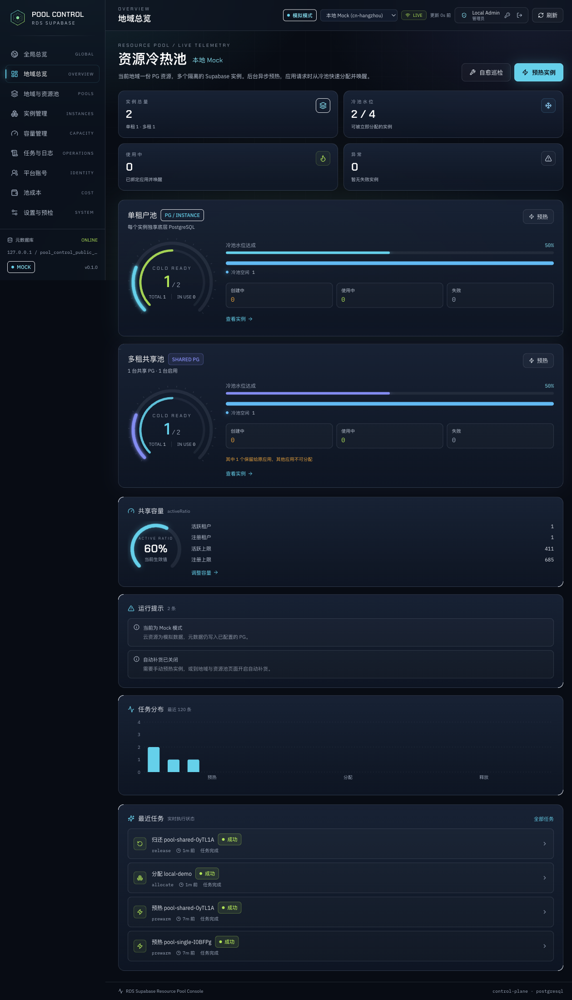
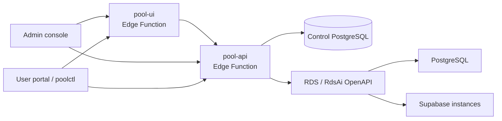

# RDS Supabase Pool Console

[中文](README.md) | English

RDS Supabase Pool Console is an experimental control plane for pre-warming Supabase instances into a cold pool and allocating them on demand. Instances are created in the background, frozen in the pool and woken up when an application requests one, avoiding the wait of creating an instance from scratch.



> **Experimental.** This project is not production-ready and provides no SLA.
>
> **Not an official Supabase product.** This project is an Alibaba Cloud open-source project and is not affiliated with, endorsed by, or sponsored by Supabase, Inc.
>
> **Cost warning.** `mock` mode does not create business PG/Supabase resources. `real` mode creates billable cloud resources. Use a dedicated test account and budget alerts. The public `bootstrap.sh` defaults to `mock`.

## Features

- Multi-region single-tenant and shared PostgreSQL pools.
- Prewarm -> cold pool -> allocate/wake -> return lifecycle.
- Shared PostgreSQL discovery, creation, capacity ratio management and optional cloud deletion.
- Admin console and user portal with separate permission boundaries.
- PAT authentication and `poolctl` CLI for user automation.
- Task orchestration, retries, self-healing, API audit and pool cost views.
- Real and mock cloud adapters.

## Architecture



The control plane runs on RDS Supabase Edge Functions. `pg_cron` and `pg_net`
drive the worker. See [docs/architecture.md](docs/architecture.md) for details.

## Quick start

Prerequisites:

- An existing RDS Supabase control-plane instance with Agent Runtime enabled.
- An HTTPS domain or reachable instance endpoint.
- Python 3.9+, Node.js 20.19+, npm, curl, bash.
- Alibaba Cloud RAM AK/SK with the permissions in [docs/deployment.md](docs/deployment.md).

```bash
export INSTANCE_NAME="ra-supabase-xxxxxxxx"
export POOL_ADMIN_PASSWORD="<strong-password>"
export ALIBABA_CLOUD_ACCESS_KEY_ID="<ram-access-key-id>"
export ALIBABA_CLOUD_ACCESS_KEY_SECRET="<ram-access-key-secret>"
export REGION="cn-hangzhou"
export CLOUD_MODE="mock"

./edge/bootstrap.sh
```

The script resolves the instance endpoint and service key, creates
`pool_admin` / `pool_control`, writes Edge Secrets, deploys `pool-api` and
`pool-ui`, installs the scheduler and runs a health check.

Open:

```text
Admin console:  https://<domain>/functions/v1/pool-ui/
User portal:    https://<domain>/functions/v1/pool-ui/portal
API:            https://<domain>/functions/v1/pool-api/api
```

For real cloud resources, explicitly set `CLOUD_MODE=real` and accept the cost
risk. See [docs/deployment.en.md](docs/deployment.en.md) for the concise
English deployment guide and [docs/deployment.md](docs/deployment.md) for the
full guide.

## User API and CLI

Create a PAT in the portal, then:

```bash
python3 -m pip install -e cli
poolctl login --url https://<domain>/functions/v1/pool-api --token pctl_xxx
poolctl regions
poolctl apply --region cn-hangzhou --mode shared --app my-app --wait
poolctl connect my-app --env
poolctl release my-app --yes --wait
```

See [docs/api.md](docs/api.md).

## Security

- Keep AK/SK, service keys, JWT secrets and database passwords in Edge Secrets or a local `0600` file. Never commit them.
- `edge/.bootstrap.env` is ignored by Git and contains deployment secrets.
- Admin sessions use HttpOnly cookies; PATs are stored as hashes with scopes and expiry.
- Users can only access their own instances. Only admins can delete resources.
- Do not publish real credentials, instance IDs or customer data in public content.

## Development

```bash
cd frontend && npm ci && npm test && npm run build
uvx ruff check cli edge
python3 -m unittest discover -s cli/tests -v
```

A local mock development path is documented in [docs/development.md](docs/development.md).

## License

Copyright 2026 Alibaba Cloud.

Apache License 2.0. See [LICENSE](LICENSE).
