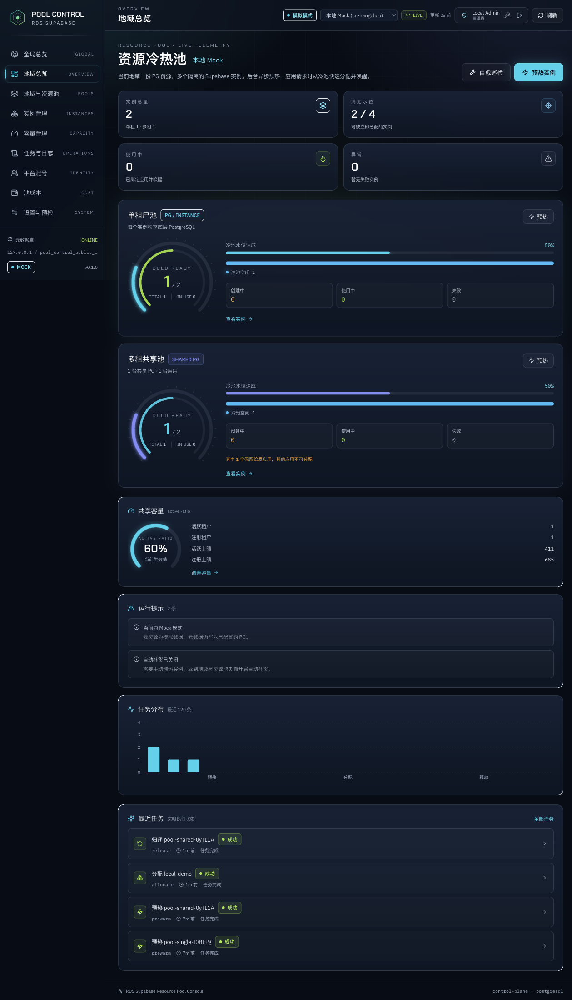
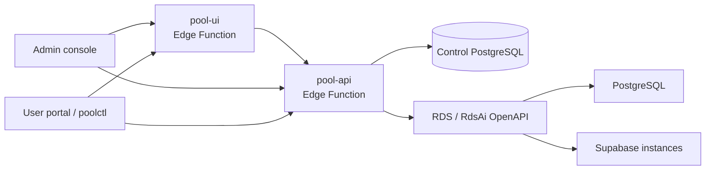

# RDS Supabase Pool Console

[中文](README.md) | English

RDS Supabase Pool Console is an experimental control plane for pre-warming Supabase instances into a cold pool and allocating them on demand. Instances are created in the background, frozen in the pool and woken up when an application requests one, avoiding the wait of creating an instance from scratch.



> **Experimental.** This project is not production-ready and provides no SLA.
>
> **Not an official Supabase product.** This project is an Alibaba Cloud open-source project and is not affiliated with, endorsed by, or sponsored by Supabase, Inc.
>
> **Cost warning.** `mock` mode does not create business PG/Supabase resources. `real` mode creates billable cloud resources. Use a dedicated test account and budget alerts. The public `bootstrap.sh` defaults to `mock`.

## Features

- Multi-region single-tenant and shared PostgreSQL pools.
- Prewarm -> cold pool -> allocate/wake -> return lifecycle.
- Shared PostgreSQL discovery, creation, capacity ratio management and optional cloud deletion.
- Admin console and user portal with separate permission boundaries.
- PAT authentication and `poolctl` CLI for user automation.
- Task orchestration, retries, self-healing, API audit and pool cost views.
- Real and mock cloud adapters.

## Architecture



The control plane runs on RDS Supabase Edge Functions. `pg_cron` and `pg_net`
drive the worker. See [docs/architecture.md](docs/architecture.md) for details.

## Quick start

Prerequisites:

- An existing RDS Supabase control-plane instance with Agent Runtime enabled.
- An HTTPS domain or reachable instance endpoint.
- Python 3.9+, Node.js 20.19+, npm, curl, bash (Node/npm are only required for source UI builds; not required when using a release artifact).
- Alibaba Cloud RAM AK/SK with the permissions in [docs/deployment.md](docs/deployment.md).

```bash
export DEPLOY_UI="release"
export POOL_UI_RELEASE_TAG="v0.1.1"

export INSTANCE_NAME="ra-supabase-xxxxxxxx"
export POOL_ADMIN_PASSWORD="<strong-password>"
export ALIBABA_CLOUD_ACCESS_KEY_ID="<ram-access-key-id>"
export ALIBABA_CLOUD_ACCESS_KEY_SECRET="<ram-access-key-secret>"
export REGION="cn-hangzhou"
export CLOUD_MODE="mock"

# Optional: enable DingTalk alerts. Leave unset to keep alerts internal only.
export DINGTALK_WEBHOOK="https://oapi.dingtalk.com/robot/send?access_token=..."
export DINGTALK_SECRET="SEC..."   # required only for a signed robot

./edge/bootstrap.sh
```

> Release mode requires `pool-ui-v0.1.1.ts` and its `.sha256` to be uploaded to the corresponding GitHub Release.
> For development or before a release exists, use `DEPLOY_UI=source ./edge/bootstrap.sh` (requires Node/npm).
> To update the API only, use `DEPLOY_UI=0 ./edge/bootstrap.sh`.

The script resolves the instance endpoint and service key, creates
`pool_admin` / `pool_control`, writes Edge Secrets, deploys `pool-api` and
`pool-ui`, installs the scheduler and runs a health check.

Open:

```text
Admin console:  https://<domain>/functions/v1/pool-ui/
User portal:    https://<domain>/functions/v1/pool-ui/portal
API:            https://<domain>/functions/v1/pool-api/api
```

For real cloud resources, explicitly set `CLOUD_MODE=real` and accept the cost
risk. See [docs/deployment.en.md](docs/deployment.en.md) for the concise
English deployment guide and [docs/deployment.md](docs/deployment.md) for the
full guide.

## Upgrade / recover an existing instance

There is no need to rerun `bootstrap.sh` on an existing instance. Run:

```bash
./edge/upgrade.sh
```

The script loads the initial deployment's `edge/.bootstrap.env`, updates `pool-api`, `pool-ui`, `pool-notifier` and the watchdog, and runs a health check.

To add or replace DingTalk alerting:

```bash
DINGTALK_WEBHOOK="https://..." DINGTALK_SECRET="SEC..." ./edge/upgrade.sh
```

If `edge/.bootstrap.env` is missing, restore the deployment configuration first by following the deployment guide. Do not use `bootstrap.sh` for upgrades or recovery on an existing instance.

## User API and CLI

Create a PAT in the portal, then:

```bash
python3 -m pip install -e cli
poolctl login --url https://<domain>/functions/v1/pool-api --token pctl_xxx
poolctl regions
poolctl apply --region cn-hangzhou --mode shared --app my-app \
  --allow-cidr 203.0.113.10/32 --wait
poolctl connect my-app --env
poolctl network my-app
poolctl release my-app --yes --wait
```

Use `--public` for all-Internet access when the pool policy allows it. Cold
instances and returns reset the Supabase instance allowlist to `127.0.0.1`.
See [docs/api.md](docs/api.md).

## Monitoring and alerts

The control plane records heartbeats for the `pool-api` request layer and the background worker chain. A `pg_cron` watchdog in `supabase_db` writes stale-heartbeat events to `alert_outbox`; a separate `pool-notifier` Edge Function sends DingTalk alerts and recovery notices.

- **`DINGTALK_WEBHOOK` is the external alert switch.** When set, DingTalk delivery is enabled. When omitted, heartbeats, the watchdog and the outbox remain active, but the notifier is not called and the main service is unaffected.
- `DINGTALK_SECRET` is only required when the robot uses signing; a keyword-secured robot does not need it.
- For a new deployment, pass both optional values to `bootstrap.sh`; it writes them to Edge Secrets.
- For an existing deployment, use `./edge/upgrade.sh`. It updates `pool-api` / `pool-ui` / `pool-notifier` and re-hooks the watchdog. It does not change Edge Secrets by default; to add or replace the webhook, run:

```bash
DINGTALK_WEBHOOK="https://..." DINGTALK_SECRET="SEC..." ./edge/upgrade.sh
```

The optional secrets are updated only when `DINGTALK_WEBHOOK` is explicitly provided; otherwise the existing configuration is preserved.
- With no webhook configured, failed delivery does not affect the service; `alert_outbox` remains available for inspection.
- `pool-ui` is a static function and has no heartbeat; monitor it with cloud monitoring or an external uptime check.

Alert text is written for customers: impact and recommended action come first; internal identifiers and heartbeat timestamps are at the end. A recovery notice is sent when service health returns.

## Security

- Keep AK/SK, service keys, JWT secrets and database passwords in Edge Secrets or a local `0600` file. Never commit them.
- `edge/.bootstrap.env` is ignored by Git and contains deployment secrets.
- Admin sessions use HttpOnly cookies; PATs are stored as hashes with scopes and expiry.
- Users can only access their own instances. Only admins can delete resources.
- Do not publish real credentials, instance IDs or customer data in public content.

## Development

```bash
cd frontend && npm ci && npm test && npm run build
uvx ruff check cli edge
python3 -m unittest discover -s cli/tests -v
```

A local mock development path is documented in [docs/development.md](docs/development.md).

## License

Copyright 2026 Alibaba Cloud.

Apache License 2.0. See [LICENSE](LICENSE).
