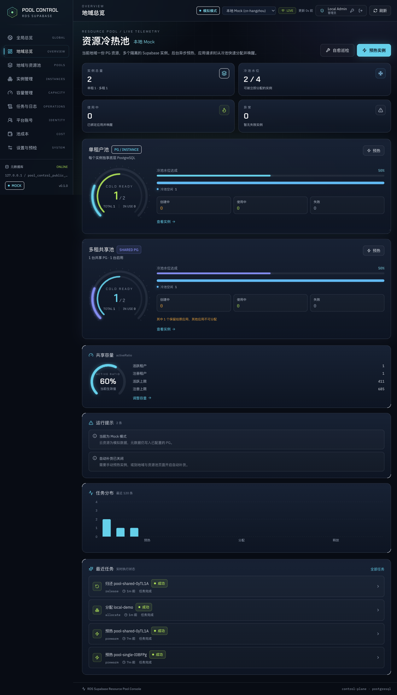
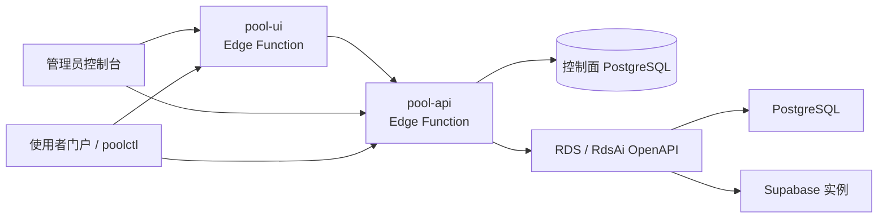

# RDS Supabase Pool Console

[English](README.en.md) | 简体中文

RDS Supabase Pool Console 是一个面向 RDS Supabase 的冷热资源池控制面：后台提前预热并冻结 Supabase 实例形成冷池，应用申请时从冷池快速分配并唤醒，减少现建实例的等待。支持单租户独享 PG、多租共享 PG、多地域、容量水位、任务审计和成本查看。



> **项目状态：实验性项目。** 本项目用于验证资源池化交付方式，不提供生产级 SLA。用于生产前请自行完成容量、安全、权限和故障演练。
>
> **非官方 Supabase 项目。** 本项目是阿里云开源项目，不是 Supabase, Inc. 的官方产品，也不代表其立场。Supabase 是其权利人的商标。
>
> **费用警告。** `mock` 模式不会创建 PG / Supabase 业务实例；`real` 模式会真实创建云资源并产生费用。请使用独立测试账号，并配置预算/费用告警。公开仓库的 `bootstrap.sh` 默认使用 `mock`。

## 功能

- **多地域资源池**：每个地域维护单租户池和多租共享池，地域之间实例、任务、容量与成本隔离。
- **冷热池生命周期**：预热 → 冷池 → 申请唤醒 → 归还停冷；支持同应用复用和直接删除。
- **两种资源模式**：
  - 单租户池：每个实例独享 PG；
  - 多租共享池：多个 Supabase 实例共享 PG，只冻结/删除租户，不删除共享 PG。
- **共享 PG 管理**：选择已有 Running PG 或直接新建；支持跨 VPC/AZ 挂载、按负载选择最空闲的 PG、容量比例管理，以及移除时可选删除云上 PG。
- **双角色边界**：管理员管理资源池与生命周期；使用者通过独立门户或 CLI 自助申请、查看连接信息并归还，全程不接触云账号凭证。
- **真实 / Mock 双模式**：Mock 模式用于本地和演示；真实模式调用阿里云 RDS / RdsAi OpenAPI。
- **运维能力**：任务状态机、失败重试、自愈巡检、API 审计、池成本统计、SSE 实时状态。

## 架构



控制面运行在 RDS Supabase Edge Functions 中，直接连接独立 PostgreSQL 数据库；`pg_cron` + `pg_net` 定时触发 worker。详细设计见 [docs/architecture.md](docs/architecture.md)，部署与权限见 [docs/deployment.md](docs/deployment.md)，接口清单见 [docs/api.md](docs/api.md)，英文入口见 [README.en.md](README.en.md)。

## 快速开始

### 前置条件

- 一台已开启 **Agent Runtime** 的 RDS Supabase 控制面实例；
- 可访问的 HTTPS 域名（`*-pb.*.apsaradb.com` 或等价域名）；
- Python 3.9+、Node.js 20.19+、npm、curl、bash；
- 阿里云 RAM AK/SK，权限要求见 [docs/deployment.md](docs/deployment.md)。

控制面实例由部署者自行创建，脚本不创建控制面实例。

### 部署（默认 Mock）

```bash
export INSTANCE_NAME="ra-supabase-xxxxxxxx"
export POOL_ADMIN_PASSWORD="<8~32 位，至少包含大写/小写/数字/特殊字符中的三类>"
export ALIBABA_CLOUD_ACCESS_KEY_ID="<RAM 用户 AK>"
export ALIBABA_CLOUD_ACCESS_KEY_SECRET="<RAM 用户 SK>"
export REGION="cn-hangzhou"
export CLOUD_MODE="mock"

./edge/bootstrap.sh
```

脚本会自动：

1. 解析实例 HTTPS 域名、service_key 和底层 PG 地址；
2. 通过 RDS API 创建 `pool_admin` 和 `pool_control`；
3. 写入 Edge Secrets、部署 `pool-api` / `pool-ui`；
4. 安装 `pg_cron` / `pg_net` 并挂调度；
5. 执行健康检查。

部署成功后访问：

```text
管理台：https://<domain>/functions/v1/pool-ui/
使用者门户：https://<domain>/functions/v1/pool-ui/portal
API：https://<domain>/functions/v1/pool-api/api
```

### 真实模式

确认使用独立测试账号并接受费用风险后：

```bash
export CLOUD_MODE="real"
./edge/bootstrap.sh
```

真实模式会创建 PG / Supabase 资源。不要在生产账号直接试用；建议先设置预算告警，并在验证后删除测试资源。

### 首次初始化

1. 打开管理台，创建第一个管理员账号；
2. 在「设置与预检」确认真实/Mock 模式并执行预检；
3. 在「地域与资源池」新增地域（VPC / VSwitch）；
4. 共享池添加 Running 的 PG，或对单租户池执行预热；
5. 在「平台账号」创建使用者账号。

## 使用者 API 与 CLI

使用者在门户创建 PAT 后，可通过 CLI 申请、查询和归还实例：

```bash
python3 -m pip install -e cli
poolctl login --url https://<domain>/functions/v1/pool-api --token pctl_xxx
poolctl regions
poolctl apply --region cn-hangzhou --mode shared --app my-app --wait
poolctl connect my-app --env
poolctl release my-app --yes --wait
```

Token 只能访问 `/api/v1/portal/*`，不能访问管理端、成本、任务日志或云凭证。详见 [docs/api.md](docs/api.md)。

## 配置与安全

- 主要配置通过环境变量注入，示例见 [.env.example](.env.example)。
- AK/SK、service_key、JWT secret、数据库密码和 worker token 只写入 Edge Secrets 或本地 `edge/.bootstrap.env`；该文件权限为 `0600` 且已加入 `.gitignore`。
- 管理台使用 HttpOnly JWT Cookie；PAT 只保存 SHA-256 哈希，支持 scope、有效期和撤销。
- 使用者只能看到并操作自己的实例；删除操作仅管理员可执行。
- 默认 Mock 模式不创建业务云资源；真实模式请使用最小权限 RAM 用户，并避免长期放开 PG 白名单。
- 不要在公开内容中粘贴真实凭证、实例 ID 或客户数据。

## 目录

```text
edge/                 Edge Function API、UI 构建、部署脚本
frontend/             管理台 + 使用者门户
cli/                  poolctl CLI
docs/                 架构与部署文档
```

## 开发

- 前端：`cd frontend && npm ci && npm test && npm run build`
- Python 检查：`uvx ruff check cli edge` 和 `python3 -m unittest discover -s cli/tests -v`
- 本地 Mock 环境：见 [docs/development.md](docs/development.md)
- 提交前请用 Mock 模式跑一遍登录、预热、分配、归还和容量展示。

## License

Copyright 2026 Alibaba Cloud.

Apache License 2.0，详见 [LICENSE](LICENSE)。
